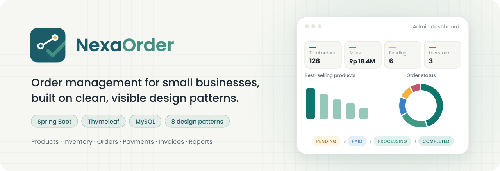
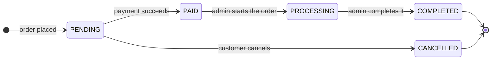
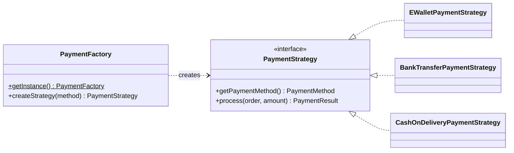
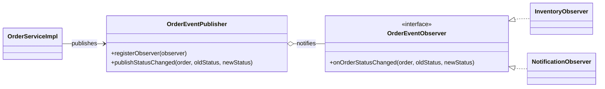
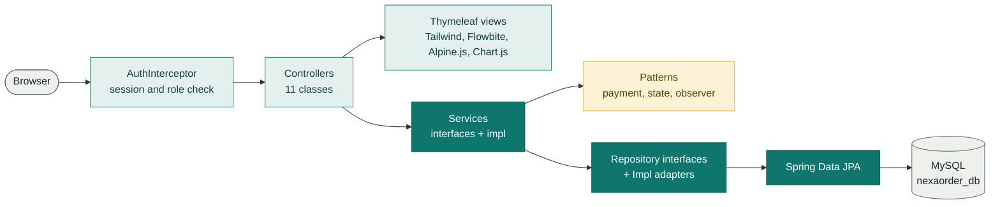
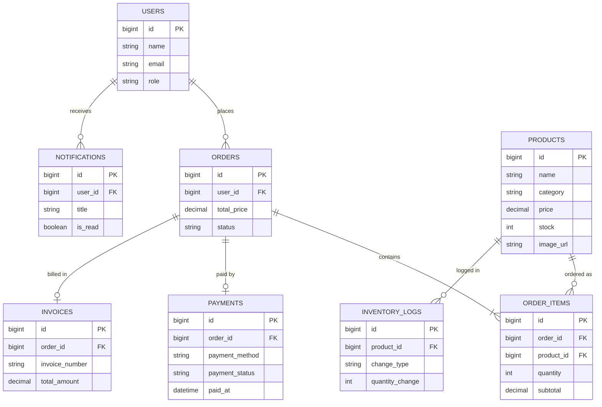

<div align="center">



<br />
<br />


<br />

🔄 [Order lifecycle](#-order-lifecycle)  ·  🧩 [Design patterns](#-design-patterns)  ·  💾 [Data model](#-data-model)  ·  🚀 [Getting started](#-getting-started)

</div>

<br />

## 📑 Contents

[About](#-about) ·
[Features](#-features) ·
[Order lifecycle](#-order-lifecycle) ·
[Design patterns](#-design-patterns) ·
[Architecture](#-architecture) ·
[Data model](#-data-model) ·
[Tech stack](#-tech-stack) ·
[Getting started](#-getting-started) ·
[Project structure](#-project-structure) ·
[Limitations](#-known-limitations-and-next-steps) ·
[Author](#-author)

---

## 📦 About

**NexaOrder** is a web-based order management system for small businesses. Admins manage products, stock, orders, payments and reports. Customers browse the catalogue, place orders, pay and follow each order until it is completed.

The code is organised so that its eight design patterns are easy to find and read. Payment, order-state and order-event logic each live in their own package and are wired together by hand, instead of being hidden behind Spring's automatic bean discovery.

> 💡 **Principle:** controllers stay thin, services hold the business rules, and every status change goes through one place, so stock, notifications and payments can never drift out of sync.

Built in June 2026 with Spring Boot, Thymeleaf and MySQL.

---

## ✨ Features

### For admins

| | Feature | What it does |
|---|---|---|
| 📊 | **Dashboard** | Total orders, sales, pending orders and low-stock products at a glance, with order-status and best-seller charts and the latest orders |
| 🛍 | **Products** | Create, edit and delete products, upload a JPEG, PNG or WebP image (up to 5 MB), search and filter by category |
| 📦 | **Inventory** | Adjust stock by hand, see products at 5 units or fewer flagged as low stock, and review every change in the inventory log |
| 🧾 | **Orders** | Move orders through their lifecycle. Only legal status changes are offered |
| 💳 | **Payments** | Confirm bank transfers that are waiting for approval |
| 📈 | **Reports** | Filter by month, read three Chart.js charts (order status, best sellers, sales summary) and export the report as CSV |
| 🔔 | **Notifications** | Get notified when a paid order is ready to process |
| 👥 | **Users** | Overview of every admin and customer account |

### For customers

| | Feature | What it does |
|---|---|---|
| 🔐 | **Accounts** | Register and log in. Each role only reaches its own pages |
| 🔎 | **Catalogue** | Browse products with search and category filter, then open a product to see details and stock |
| 🛒 | **Ordering** | Create an order with a quantity selector and a live subtotal |
| 💸 | **Payment** | Pay by e-wallet, bank transfer or cash on delivery |
| 📜 | **Order history** | Follow every order, and cancel it while it is still pending |
| 🔔 | **Notifications** | Get an update each time an order is paid, processed, completed or cancelled |
| 🖨 | **Invoices** | Open a printable invoice for any order |

<!--
## 📸 Screenshots

Put the images in docs/readme/ and remove this comment block.

<p align="center">
  
  
  
  
</p>
-->

---

## 🔄 Order lifecycle



Each status is a class in [`pattern/state`](src/main/java/com/raihan/nexaorder/pattern/state). A state only allows its own next steps, and any other request throws an error, so an order can never jump from `PENDING` to `COMPLETED` or be reopened after it is cancelled.

How the payment method decides what happens next:

| Method | Payment status | Order status |
|---|---|---|
| E-wallet | `PAID` straight away | `PAID` |
| Bank transfer | `WAITING_CONFIRMATION` until an admin confirms it | stays `PENDING`, then `PAID` |
| Cash on delivery | `PENDING`, collected on delivery | `PAID`, so the order can be processed |

When an order becomes `PAID`, two observers react to the same event:

- **`InventoryObserver`** checks that every item is still in stock, reduces the stock and writes an `OUT` entry to the inventory log.
- **`NotificationObserver`** tells the customer the payment is confirmed and tells every admin that a new order is ready.

Invoices are created the first time someone opens them, with numbers like `INV-2026-0001`.

---

## 🧩 Design patterns

| Pattern | Where | What it does |
|---|---|---|
| **MVC** | `controller/`, `service/`, `templates/` | Controllers handle requests, services hold business rules, Thymeleaf renders the pages |
| **Repository** | `repository/` | Project-owned interfaces such as `ProductRepository` are implemented by adapters such as `ProductRepositoryImpl`. Spring Data is only the storage detail behind them |
| **DTO** | `dto/` | 14 request and response classes carry form and page data, so views never receive entities |
| **Strategy** | `pattern/payment/` | One class per payment method, all behind `PaymentStrategy` |
| **Factory Method** | `PaymentFactory`, `OrderStateFactory` | Build strategy and state objects by hand, without Spring auto-discovery |
| **State** | `pattern/state/` | `PendingState`, `PaidState`, `ProcessingState`, `CompletedState` and `CancelledState` each allow only their own transitions |
| **Observer** | `pattern/observer/` | `OrderEventPublisher` informs `InventoryObserver` and `NotificationObserver` of every status change |
| **Singleton** | `PaymentFactory`, `OrderStateFactory`, `InvoiceNumberGenerator` | Private constructor and a single `getInstance()` |

### Payment: Strategy and Factory Method



### Order events: Observer



---

## 🔩 Architecture



- **Route protection.** `AuthInterceptor` guards `/admin/**` and `/customer/**`. A customer who opens an admin page is sent back to their dashboard, and the other way round.
- **Thin controllers.** Controllers validate input through DTOs and call services. All database access goes through the repository layer.
- **Hand-wired patterns.** `OrderServiceImpl` registers its observers itself, and the factories create strategies and states directly, so the patterns are visible in the code.

---

## 💾 Data model

Eight MySQL tables, created by Hibernate on first run:



---

## 🧰 Tech stack

| Layer | Technology |
|---|---|
| Language | Java 17 |
| Backend | Spring Boot 4.0, Spring MVC, Spring Data JPA, Bean Validation, Lombok |
| Database | MySQL |
| Views | Thymeleaf |
| UI | Tailwind CSS, Flowbite, Alpine.js |
| Charts | Chart.js |
| Auth | Custom login with `HttpSession` and a route interceptor |
| Build | Maven (wrapper included) |

---

## 🚀 Getting started

### Requirements

- JDK 17 or later
- MySQL 8 (a local install or Laragon both work)
- Internet access in the browser, because the UI libraries load from CDNs

### 1. Create the database

```sql
CREATE DATABASE nexaorder_db;
```

Check `src/main/resources/application.properties` and change the username or password if your MySQL setup is different:

```properties
spring.datasource.url=jdbc:mysql://localhost:3306/nexaorder_db?useSSL=false&serverTimezone=UTC
spring.datasource.username=root
spring.datasource.password=
spring.jpa.hibernate.ddl-auto=update
```

Hibernate creates the tables on the first run.

### 2. Run the app

```bash
# macOS / Linux (the first time, run: chmod +x mvnw)
./mvnw spring-boot:run

# Windows
.\mvnw.cmd spring-boot:run
```

Then open **http://localhost:8080**.

### 3. Log in with a demo account

The app creates these accounts if they don't exist yet, and adds demo products when the product table is empty:

| Role | Email | Password |
|---|---|---|
| Admin | `admin@nexaorder.com` | `admin123` |
| Customer | `customer@nexaorder.com` | `customer123` |

### Demo flow

1. Log in as the admin and look at the dashboard.
2. Open **Products**, create or edit a product and upload an image.
3. Open **Inventory** and adjust the stock of a product.
4. Log in as the customer, browse the products and create an order.
5. Pay with **E-wallet** (instantly `PAID`), **Bank transfer** (waits for the admin) or **Cash on delivery**.
6. Log in as the admin again, confirm any bank transfer, then move the order to `PROCESSING` and `COMPLETED`.
7. Open **Reports**, check the charts and export the CSV.
8. Open the order and print its invoice.

### Other commands

```bash
./mvnw -DskipTests compile   # compile without starting the app
./mvnw test                  # run the tests
mysqldump -u root -p nexaorder_db > nexaorder_db.sql   # export the database
```

Uploaded product images are saved in `src/main/resources/static/uploads/products`, and only their URL is stored in the database. Products without an image show a placeholder.

---

## 📂 Project structure

```text
src/main/java/com/raihan/nexaorder/
├── config/              AuthInterceptor, WebConfig, DataSeeder, global exception and model advice
├── controller/          Auth, dashboard, products, inventory, orders, payments, reports, invoices, notifications, users
├── dto/                 Request and response objects
├── entity/              JPA entities for the eight tables
├── enums/               Roles, order status, payment method and status, inventory change type
├── repository/          Repository interfaces, Impl adapters and Spring Data delegates
├── service/             Service interfaces
│   └── impl/            Business rules
├── pattern/
│   ├── payment/         Strategy + Factory Method
│   ├── state/           State
│   └── observer/        Observer
└── util/                InvoiceNumberGenerator, SessionUtil, DateFilterUtil

src/main/resources/
├── templates/           admin/, customer/, auth pages, layouts and shared fragments
├── static/              CSS, JS, logo and uploaded images
└── application.properties
```

---

## 🚧 Known limitations and next steps

- Passwords are stored without hashing. A real deployment needs BCrypt and Spring Security.
- Payments are simulated. There is no real payment gateway.
- The UI libraries load from CDNs, so the pages need an internet connection.
- Uploaded images are saved inside the source folder, which suits a local demo but not a packaged release.
- The automated tests only check that the application starts. Service-level tests for the state rules and payment strategies would be the next step.

---

## 👤 Author

**Raihan Aditito Bagastama (韩子杰)**<br />
Software Engineering, Nanjing Xiaozhuang University

[GitHub](https://github.com/RizMastah) · [LinkedIn](https://www.linkedin.com/in/raihan-aditito)

<br />

<p align="center"><sub>Nanjing Xiaozhuang University · June 2026</sub></p>
